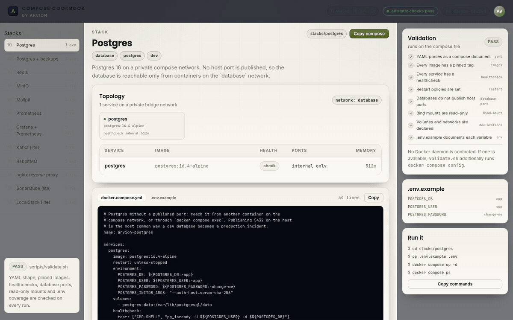
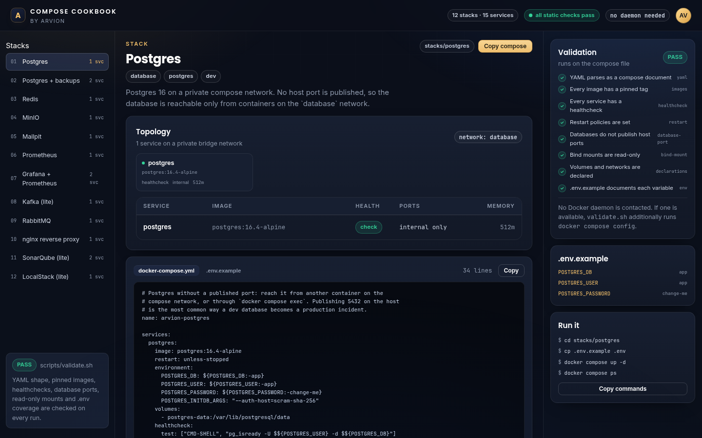

<div align="center">

</div>

<sub>Recorded from the live demo — <a href="docs/demo.mp4">MP4</a> · <a href="docs/screenshot.png">static frame</a></sub>

# Compose Cookbook

Twelve Docker Compose stacks for local development and small deployments:
Postgres, backups, Redis, MinIO, Mailpit, Prometheus, Grafana, Kafka, RabbitMQ,
an nginx proxy, SonarQube and LocalStack. Every stack pins its images, defines
healthchecks and resource limits, keeps databases off the host network, and ships
with a `.env.example` and a README.

[**Open the live demo**](https://arvion-technology.github.io/labs/demos/compose-cookbook/demo/) · [MIT](LICENSE)

---

Copying a compose snippet from a blog post is how a dev database ends up on
`0.0.0.0:5432`. This repository is the version that was reviewed: images are
pinned, services have healthchecks, stateful data lives in named volumes, bind
mounts are read-only, and a linter checks those properties on every run — without
needing a Docker daemon.

The catalog demo is generated from the compose files themselves. The validation
panel runs the same linter as `scripts/validate.sh` against the YAML in the panel,
so the green checks are not screenshots of a previous run.

## The stacks

| Stack | Services | Use it for |
| --- | --- | --- |
| `postgres` | postgres | A private Postgres 16 with SCRAM auth |
| `postgres-backup` | postgres, backup | Scheduled `pg_dump` with rotation |
| `redis` | redis | AOF persistence, password, bounded memory |
| `minio` | minio | S3-compatible storage and console |
| `mailpit` | mailpit | SMTP sink and inbox UI for development |
| `prometheus` | prometheus | Metrics scraping with retention |
| `grafana-stack` | prometheus, grafana | Prometheus + provisioned Grafana |
| `kafka-lite` | kafka | Single-node KRaft broker, no ZooKeeper |
| `rabbitmq` | rabbitmq | AMQP with the management UI on localhost |
| `nginx-proxy` | nginx | TLS termination and HTTP-to-HTTPS redirect |
| `sonarqube-lite` | db, sonarqube | SonarQube Community with its own Postgres |
| `localstack-lite` | localstack | S3 and SQS emulation with persistence |

Each directory contains `docker-compose.yml`, `.env.example` and a README with
run, connect and restore notes.

## Screenshots

| Postgres stack | Grafana stack |
| --- | --- |
|  |  |

## Architecture

```
stacks/<slug>/
  docker-compose.yml     the artifact; pinned image, healthcheck, limits
  .env.example           every variable the file references
  README.md              run / connect / restore notes
        │
        ▼
scripts/sync-demo.mjs ──► demo/stacks-data.js   (generated, committed)
        │                        │
        ▼                        ▼
src/yaml.js ──► src/lint.js ──► demo/app.js (validation panel)
                     │
                     ▼
              scripts/validate.mjs  ──►  scripts/validate.sh
```

The demo does not `fetch()` the compose files, because the static host only serves
`demo/`. Instead `sync-demo.mjs` embeds the file contents into
`demo/stacks-data.js`; `test/stacks.test.js` fails if that file is stale. The
catalog, the test suite and the validator therefore read the same bytes.

The linter's rules are deliberately explicit. Errors are the ones that cause real
problems; warnings are judgement calls:

```text
error   unpinned-image      no tag or :latest
error   image               missing or invalid image reference
error   healthcheck         no healthcheck.test
error   restart             no restart policy
error   database-port       postgres/mysql/redis publishes a host port
error   bind-mount          a host path is mounted read-write
error   privileged          privileged: true
error   host-network        network_mode: host
error   volume-declaration  a named volume is used but not declared
error   network-declaration a network is used but not declared
warn    resources           no mem_limit or cpus
warn    healthcheck-detail  no interval, timeout or retries
warn    env-example         ${VAR} referenced but missing from .env.example
```

The checker lives in `src/lint.js` on top of `src/yaml.js`, a small YAML parser
that supports exactly the subset these files use (block maps, sequences, flow
arrays, quoted strings, comments). It does not pretend to be a YAML
implementation; unknown constructs fail loudly.

## Quickstart

```bash
git clone https://github.com/arvion-technology/compose-cookbook.git
cd compose-cookbook

make list                 # twelve stack names
make validate             # static checks; no daemon needed
make up STACK=postgres    # copies .env.example to .env if missing
make ps STACK=postgres
make down STACK=postgres
```

Or directly:

```bash
cd stacks/redis
cp .env.example .env      # change the password
docker compose up -d
docker compose exec redis redis-cli -a "$(grep REDIS_PASSWORD .env | cut -d= -f2)" ping
```

`make validate` runs the same check in CI. If a Docker daemon is available,
`scripts/validate.sh` also runs `docker compose config` on each file as a second
opinion; without a daemon it prints that and exits on the static result.

## How it works

**Pinned images, not `latest`.** A compose file without a tag silently upgrades
the database on the next `pull`. The linter rejects both `image: postgres` and
`image: postgres:latest`; every stack uses a specific version.

**Healthchecks that check the service.** `pg_isready -U $POSTGRES_USER -d
$POSTGRES_DB` proves the server accepts connections as the configured user, unlike
a TCP check that passes while the database is still initialising. Services that
depend on a database wait with `condition: service_healthy`.

**Databases stay internal.** No database stack publishes a host port. Reach it
with `docker compose exec db psql` or put the application on the same network.
The one exception the linter allows is a `127.0.0.1:` binding, and even that is a
warning.

**Bind mounts are read-only.** Config files are mounted `:ro`; everything mutable
is a named volume. That keeps a compromised container from editing the config that
the next restart will read.

**The static validator is a real test.** `scripts/validate.mjs` parses every file,
runs the rules and exits non-zero on an error. `npm test` additionally checks all
twelve stacks pass with zero errors and zero warnings, so a regression fails CI
without Docker.

## Tests

```bash
npm test        # 24 tests
make validate   # linter over all twelve stacks
```

- `test/yaml.test.js` — nested mappings, sequences, flow arrays, comments,
  quoted strings, null values, invalid indentation and tabs.
- `test/lint.test.js` — one test per rule, from unpinned images and exposed
  database ports to read-write mounts, undeclared volumes and undocumented
  variables.
- `test/stacks.test.js` — all twelve stacks present and documented, zero lint
  errors or warnings, every service pinned and healthchecked, no database ports,
  catalog derivation, and the generated demo data matching the files on disk.

## Limitations

- **Images are pinned, not scanned.** Pinning fixes drift, not vulnerabilities.
  Add Trivy or Grype to CI and decide your own CVE policy; this repository does
  not pretend to have one.
- **Healthchecks are declared, not exercised here.** Validation checks their
  shape. CI does not start the containers, so an image whose healthcheck binary
  was removed would only fail at runtime.
- **These are small-deployment stacks.** Single node, no replicas, no failover.
  Postgres and Kafka are configured for one instance; production needs a plan for
  the stateful pieces that compose does not give you.
- **Secrets are `.env` placeholders.** Compose `env_file` is readable by anything
  with repository access. Use Docker secrets, a vault, or a deployment platform
  for real credentials; the examples say `change-me` for a reason.
- **No automatic TLS.** The nginx stack expects a certificate in the `certs`
  volume. Certificate issuance (certbot, ACME) is deliberately out of scope.
- **Software licences vary by stack.** SonarQube Community, LocalStack and the
  backup image have their own licences and terms. Check them before commercial
  use; the repository's MIT licence covers these files, not the images.

## Project layout

```
stacks/
  postgres/              private Postgres, no published port
  postgres-backup/       pg_dump sidecar with rotation
  redis/                 AOF + password + LRU
  minio/                 S3-compatible storage
  mailpit/               SMTP sink
  prometheus/            metrics scrape + retention
  grafana-stack/         Prometheus + provisioned Grafana datasource
  kafka-lite/            single-node KRaft broker
  rabbitmq/              AMQP + management UI on localhost
  nginx-proxy/           TLS termination config
  sonarqube-lite/        SonarQube + Postgres
  localstack-lite/       S3/SQS emulation
src/
  yaml.js                YAML subset parser
  lint.js                compose rules and severity mapping
  catalog.js             stack metadata and catalog derivation
scripts/
  validate.sh            the CI entry point
  validate.mjs           parsing and rule execution
  sync-demo.mjs          regenerates demo/stacks-data.js
demo/                    browsable catalog; imports the generated data
Makefile                 list / validate / up / down / logs / sync
```

## Credits

Built by [Arvion Technologies](https://arviontech.net) in Kathmandu. MIT licensed.
